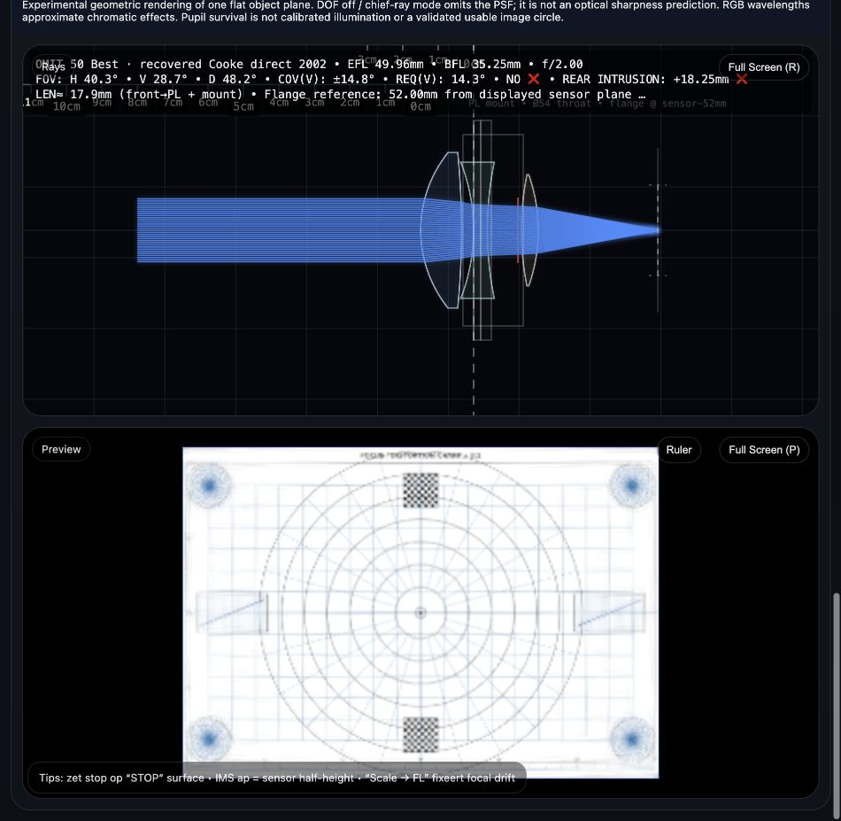

# Recovered OMIT 50 presets

The old “Load OMIT 50 preset” was a concept design, not the optimized benchmark. It is preserved as **Load OMIT 50 Concept**. **Load OMIT 50 Best** now fetches `lenses/omit50-best.json` directly. It does not run synthesis or optimization. It loads fixed focus, zero shift and the original saved infinity image plane. Object distance switches to infinity. Use manual/auto focus explicitly for finite-conjugate experiments.

## Recovery and fair selection

Read all JSON blobs reachable from all fetched local/remote Git refs, including development branches, benchmark fixtures, saved experiment reports and older versions. **53 blobs, 236 unique complete OBJ-to-IMS prescriptions** were inspected and freshly evaluated. The former `/tmp/lensbuilder-m9-checkpoints` directory was not present; recovery does not depend on it. Sources include Git blob IDs and JSON paths in `benchmarks/omit50-recovery.json`. Nothing was generated or re-optimized.

All candidates were evaluated with the SAME frozen OMIT50 specification and 48 operands: EFL 50±1 mm, f/2±0.02, requested circle 46.3 mm, fields 0/.3/.5/.7/.85/1, F/d/C spectral weights 1/2/1, apertures f/2, 2.8, 4, 5.6 and dense 19-grid sunflower validation. The common evaluator sets the same test apertures for each candidate; archived iris variants can therefore tie. The original f/2 saved variant is preferred on ties. Hard geometry/material/coverage-survival constraints are unchanged. 148 recovered prescriptions pass this contract; invalid entries remain in the report, not silently discarded.

| Candidate | Common merit | Center RMS µm | Mid RMS µm | Edge RMS µm | Minimum sampled ray fraction |
|---|---:|---:|---:|---:|---:|
| Historical M4 block-DLS | 211.699182 | 97.399 | 128.198 | 309.609 | 97.18% |
| Later refined historical lens | 211.067965 | 99.704 | 123.982 | 305.492 | 97.18% |
| Recovered Cooke direct 2002 (**Best**) | **191.718231** | **96.927** | **96.110** | **290.156** | **82.39%** |

The selected lens is the previously saved v1.1 Cooke candidate from `benchmarks/omit50-challenge-new.json`, introduced with the archived report at commit `5170628`. It is NOT the M4 winner and is not a new design from this task. It wins the common aggregate merit, but has more clipping and worse longitudinal color than the historical lens. “Best” is scoped to this frozen objective and recovered set, not a universal optical-quality claim. Independent 23-grid holdout merit is **192.94246683010118**, with the same hard-constraint pass.

## Permanent complete prescriptions

- `lenses/omit50-best.json`: original Cooke surfaces, clear apertures, stop, glass names, reference geometry, verified Sellmeier material records, common specification/operands, original run ID `cooke-direct-2002`, seed encoded in that run ID, 10,000/10,000 evaluation budget and contract `da831e50`.
- `lenses/omit50-historical-m4.json`: exact historical 211.6991817575039 block-DLS winner; seed 1001, 3,000-call budget, original variable bounds and objective. Its original full optimization trace remains in `benchmarks/omit50-methods-v1.json`. This file can also be loaded through Load Lens.
- No missing surface parameters were fabricated. Both contain OBJ, every physical surface and IMS. Thickness is the axial distance to the next vertex, in mm. OBJ/first vertex is x=0; IMS is the sum of preceding thicknesses. The preserved IMS aperture is a tracing field boundary, not proof of usable image circle.

Selected Best numerical checks at nominal saved focus:

| Quantity | Expected |
|---|---:|
| EFL | 49.95648830164519 mm |
| Geometric f-number | 2.00000000000000 |
| Paraxial BFL | 35.25104186914508 mm |
| Last surface → image plane | 33.75119698467775 mm |
| Dense merit | 191.71823128235255 |
| Center / edge RMS | 0.09692741475300694 / 0.29015563300822717 mm |

Regression tolerances: first-order values and merit 1e-9 absolute; center/edge RMS 1e-6 mm. The browser-loaded nine surface rows were compared against the JSON: radii, thicknesses, apertures, glasses and stop agree exactly; focus remains fixed at 0.0000 mm. The browser displays 49.96 mm, f/2.00, BFL 35.25 mm and infinity object distance. The concept button remains available separately.

These dense multiwavelength values use the original fixed image plane. They differ legitimately from the monochromatic, autofocus-adjusted M4 preview measurements in `PREVIEW_FOCUS_VALIDATION.md`. Do not mix those settings when comparing performance.

A 46.3 mm target, BFL, 52 mm PL flange distance and mechanical rear clearance are distinct. Neither preset is certified sharp, manufacturable, PL-compatible or unvignetted over a validated 46.3 mm usable circle.

Reproduce recovery: `node tools/recover-omit-presets.cjs`. The inventory grows when more history is committed, while optical duplicates remain deduplicated. Reproduce permanent-preset checks: `node --test tests/omit-preset.test.cjs`.

Browser proof of the loaded saved Best prescription and completed geometric preview:

