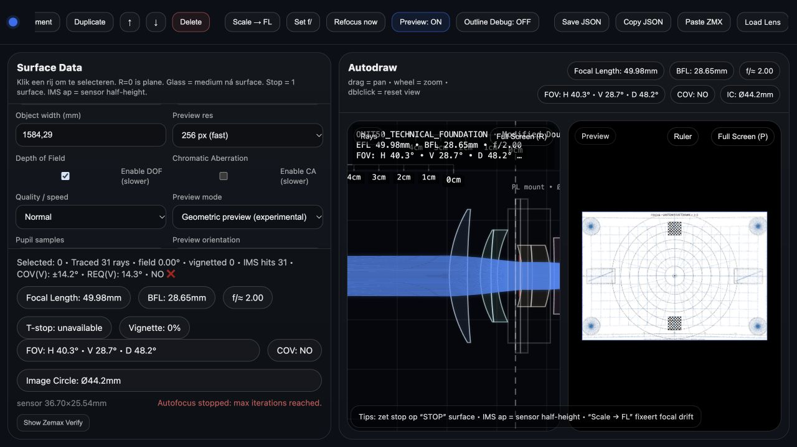
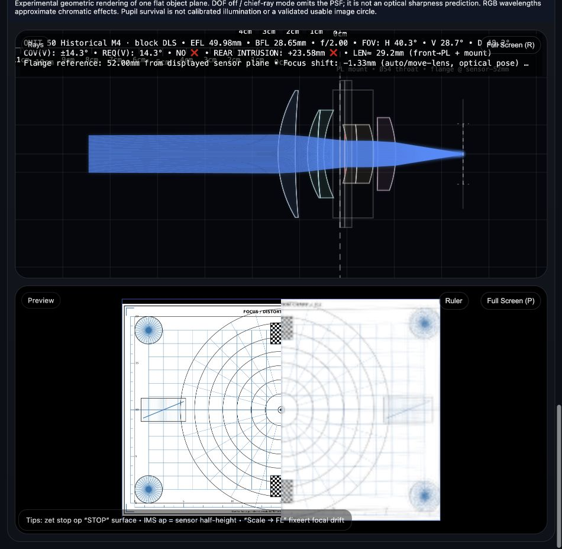

# Geometric preview and focus correction — v1.1.1

This implements the requested “v0.9.1” milestone on top of the already published v1.1.0. No later milestone is removed. No existing PR is merged and no deployment is triggered by this work.

## Repository / release audit (2026-11-07)

- Publication/default branch: `feat/validated-lens-optimization`, commit `98c0f9514d46cb6858db4ea1841bcfba43d1981b`; no `main` branch exists in the fetched branch list.
- PRs #3–#8 are already merged. #6 was integrated into the stacked #5 branch before #5 reached publication. Do not merge these PRs again.
- Pages publishes `/` of the publication branch; API reports `built`.
- Actual live `build-info.js` reports **1.1.0**, source SHA256 `04b51fdf6c89115afcabe33e16d6e7599f351b08e3557ff8459fb0bda83475b3`. Its recorded `baseCommit` is a stamping parent, not the Pages merge commit.
- Correct integration: this single feature branch into the current publication branch, with a merge commit after explicit approval and revalidation if that branch advances.

## Confirmed problems and fixes

1. **Wrong focus metric and acceptance.** Autofocus minimized reverse object-space spread, accepted safe shifts even when RMS was null, and had a fine-search endpoint that moved with each new best point. Default null field height was converted to zero. Replaced active autofocus with bounded deterministic search of forward sensor-plane centroid RMS, real stop aiming, fixed field weights, and rejection of invalid/boundary solutions. Failed fields cannot silently disappear from the objective.
2. **Inconsistent focus geometry.** Reverse rays began 0.05 mm behind the sensor; moving the lens also moved the object plane. Reverse rendering now starts exactly on the numerical sensor plane, and the object stays at a fixed coordinate relative to the nominal first vertex. Infinity autofocus uses parallel rays. Scene rendering at infinity uses direction slopes rather than a finite intersection.
3. **Incorrect pupil targeting and artificial blur.** Rays aimed in a straight line at the internal stop without accounting for refraction; the fast LUT substituted an empirical spread kernel with a 1.15 multiplier. Removed that path. Actual reverse rays are iteratively aimed through the refracted stop with shared spherical intersections and Snell refraction. No added blur, sharpening, jitter blur or empirical cos⁴ darkening remains.
4. **DOF switch was ignored in explicit quality mode.** DOF off now means a chief-ray mapping, clearly marked “PSF omitted”. DOF on integrates deterministic equal-area pupil samples (16/32/64 supported). This models a single flat object plane, not a fabricated depth map of a photograph.
5. **Clipping and image-circle errors.** Normalizing only surviving samples hid clipping. All launched samples now contribute to the denominator. A photograph's luminance/blue content no longer determines the image circle. Requested coverage, sampled field extent, annular mean pupil survival and unvalidated usable coverage are separate. The 35% survival estimate is limited to complete sampled annuli inside sensor height. It is not a 46.3 mm coverage certificate.
6. **Stale state.** Saving focus without an override converted null to zero. Autofocus cache omitted prescription changes. Preview caching reset IC before a cache hit and could mark an unfinished render cached. These are corrected. Image loads have generation guards, revision keys and cancellation; older asynchronous loads cannot replace a newer image. Failed replacement clears the old preview.
7. **Comparison and resources.** Original, simulation, before/after, center and corner crops added. Crops use one rendered pixel per CSS pixel. Uploaded images retain aspect ratio; preview source canvases and output are bounded to 1920 pixels on their long edge. Worker termination cancels rendering; output is committed atomically after completion.

## Independent optical references

`tests/preview.test.cjs` checks a 5 mm thick, n=1.5, R=±50 mm singlet at small aperture against independently calculated ABCD conjugates. The matrix is A=D=29/30, B=10/3, C=−59/3000. Rear conjugate is 2900/59 mm at infinity and −(As+B)/(Cs+D) at finite distance. Focus agrees within 0.002 mm. Additional tests cover actual sensor intersections, forward/reverse reciprocity through a refracted stop, fixed object coordinates, invalid minima, deterministic sampling, aspect/memory bounds, focus persistence, source generations and the actual worker's source/mode/focus/orientation behavior.

## OMIT 50 acceptance

Exact unchanged fixture: `benchmarks/physical-omit50.json#system` (historical serialized M4 winner, not a newly synthesized replacement). Reproduce with `npm run benchmark:preview`; complete results including DOF off/on and 16/32/64 reverse sampling are in `benchmarks/preview-omit50.json`.

- EFL **49.980664 mm**, nominal f/**2.000000**; requested circle **46.3 mm**.
- Paraxial BFL **28.651743 mm**; nominal rear-surface-to-sensor gap **27.090728 mm**. Neither is the PL flange distance or mechanical rear clearance.
- Monochromatic d-line, 64 samples for focus, 256 independently resampled rays for reported RMS. Positive x points toward the sensor; a negative lens shift moves the whole lens toward the object, sensor fixed.

| Object | Lens shift mm | Center RMS mm | RMS at nominal image height 23.15 mm | Edge survival |
|---|---:|---:|---:|---:|
| Infinity | −0.168945 | 0.091840 | 0.377546 | 245/256 |
| 2000 mm | −1.328125 | 0.095792 | 0.363450 | 251/256 |

The edge field uses tan(angle)=23.15/EFL; actual centroid heights are 23.0760 and 23.1955 mm respectively. These are sampled geometric results, not an MTF-qualified image circle.

The unchanged v1.1 browser selected −1.7504 mm at 2 m and displayed “max iterations reached”. Evaluating that observed shift with the same forward metric gives **0.122324 mm** center RMS versus **0.095792 mm** after correction (about 22% lower). The zero-shift prescription gives 0.257332 mm at 2 m. These comparisons must not be confused: zero shift is not the old browser autofocus result.

DOF off has one chief ray and no spot distribution; its zero sample spread is **not optical sharpness**. DOF on produces nonzero ray-derived spread at both distances. The prescription remains substantially aberrated; no claim of optical sharpness, manufacturability or PL compatibility is made.

## Experimental / unavailable

Geometric paths and focus use the tested numerical kernel, but the photo renderer remains experimental: equal stop-area sample weights are not a calibrated radiometric pupil Jacobian; RGB spectral sampling is approximate; no coatings, polarization, diffraction, scatter, ghosts or arbitrary scene-depth reconstruction are claimed. Use the separate physical PSF/MTF tools for their validated scope. Small pupil sample counts can show sampling artifacts. 1920/64 is computationally expensive and cancellable; the browser test covers starting/cancelling this size, not a claimed full-resolution throughput benchmark. The original image comparison preserves aspect but is not a distortion-registered reference.

## Verification

- All 223 tests pass (206 existing tests plus 17 added regression tests). Preset recovery is documented separately in [OMIT50_PRESET_RECOVERY.md](OMIT50_PRESET_RECOVERY.md).
- 189 geometric benchmark prescriptions: maximum dense-merit difference **0**.
- 16 physical configurations: exact RMS/PV/status agreement. Frozen benchmark files are unchanged.
- JavaScript syntax checks pass; existing optimization benchmark accepts its validated improvement.
- Local browser tested under `/LensBuilder2027/`: same OMIT fixture, 2 m and infinity, DOF off/on, completed 16/32/64 samples, new worker loading, 1920 start/cancel, comparison modes and file replacement. No captured JavaScript errors in these tests.

Before (unchanged publication code, same prescription at 2 m):

After (corrected focus and comparison interface):

Screenshots use the same 256 setting; v1.1 interprets it as height, v1.1.1 as long edge. They demonstrate UI behavior, not a pixel-matched optical benchmark. Numerical results above are the quantitative comparison.

## Safe publication — not executed

1. Review this PR against `feat/validated-lens-optimization`; obtain explicit merge/deployment approval.
2. Fetch GitHub again. If publication advanced beyond `98c0f95`, integrate it with a normal merge on the feature branch, resolve changes and rerun tests, syntax, geometric/physical regressions and browser tests. Do not reset/force-push.
3. Merge this PR once with a **merge commit** to preserve history. Do not re-merge PRs #3–#8, squash or rebase the existing implementation history.
4. That publication-branch update triggers Pages. Wait for successful Pages deployment and verify its commit is the new merge commit.
5. Open the canonical live URL, check version 1.1.1 and source fingerprint, account for browser/CDN cache, then repeat the OMIT focus/preview checks. Check `optics/preview-worker.js` and its relative imports under `/LensBuilder2027/`, plus existing Studio/Search/physical workers.
6. Only then announce publication. Until then the live version remains 1.1.0.
